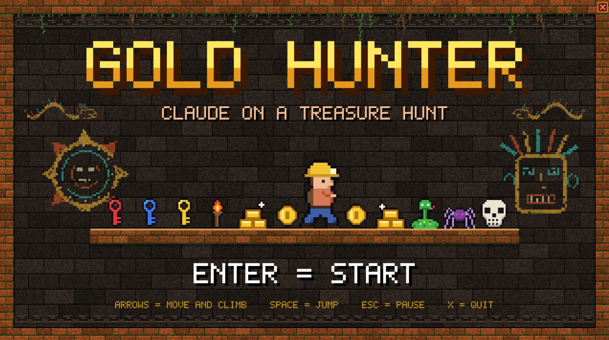
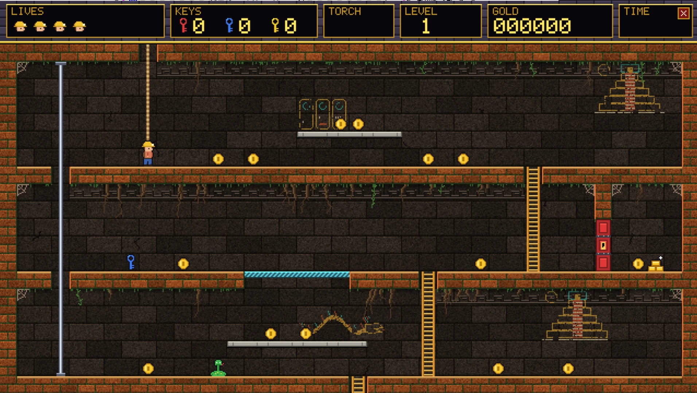
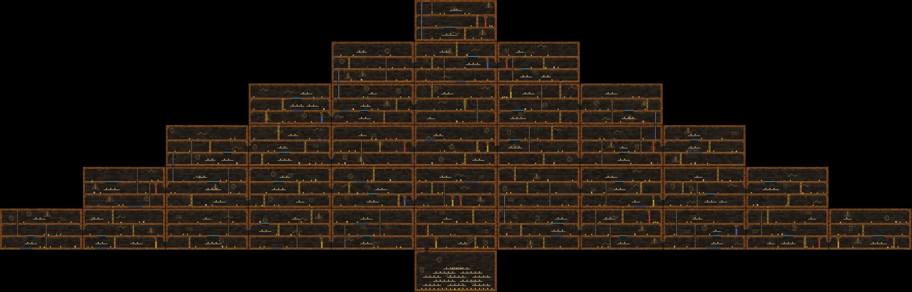

# Gold Hunter

*Claude on a treasure hunt* – a classic jump and run written entirely in LabVIEW.

Claude climbs down into an underground pyramid of 36 rooms. On the way down, Claude collects as much gold as possible, finds
red, blue and yellow keys for the doors and avoids spiders, snakes and rolling skulls. A torch lights up the dark rooms.
The deepest point of the pyramid leads into the treasure chamber. After that comes the next level, with a new colour
scheme, faster enemies and earlier darkness.

## Built with the LabVIEW MCP

This game was created with the **[LabVIEW MCP](https://github.com/Zuehlke/labview-mcp)** and its **Python backend**
(pylabview). Claude did not use the LabVIEW editor to draw the block diagrams. Instead, Python generators in `build\`
describe every VI, and the MCP turns those descriptions into real VIs, libraries and the project. It then lays out the
diagrams, runs the tests and verifies the result.

## Playing

Requirements: LabVIEW 2020 (32-bit) on Windows, and a screen of at least 1280 × 720.

Open `GoldHunter.lvproj`, run `Main.vi` and click into the window.

| Key | Action |
|---|---|
| Enter | start the game, confirm the name |
| ← / → | walk |
| ↑ / ↓ | climb ladders and ropes |
| Space | jump |
| Esc | pause |
| X | quit |

You start with 4 lives and get an extra life every 10,000 points. The top 5 scores are kept in a highscore table.
Without input, the title screen alternates with the highscore table and a demo that plays all the way into the treasure
chamber.

## The world

Each room is 40 × 20 tiles. The game has ladders, ropes, sliding poles, thin floors, crumbling floors and conveyor belts.
Each of the 20 locked doors needs a key of its colour, and a key opens only one door. A Python checker
(`build\check_levels.py`) works through every order in which the doors can be opened. It proves that the treasure chamber
is always reachable and that no choice of doors leads into a dead end.

## Project layout

| Folder | Contents |
|---|---|
| `Main.vi` | the application: four loops for keys, engine (60 Hz), rendering and audio |
| `Source\` | the libraries `GH_App`, `GH_Engine`, `GH_Render`, `GH_Audio` and others |
| `Tests\` | `Test_Run` (plays key sequences against the engine) and `Snapshot_Run` (renders frames to PNG) |
| `Resources\` | rooms, sprites, sounds and music; all of them are generated |
| `build\` | the Python generators for the VIs, graphics, levels, sounds and music |

The design is documented in German in [ARCHITEKTUR.md](ARCHITEKTUR.md).

## License

Copyright © Jean-Claude Mengisen. Licensed under the [Apache License 2.0](LICENSE).
If you use parts of this project, keep the copyright and license notices and say what you changed.
