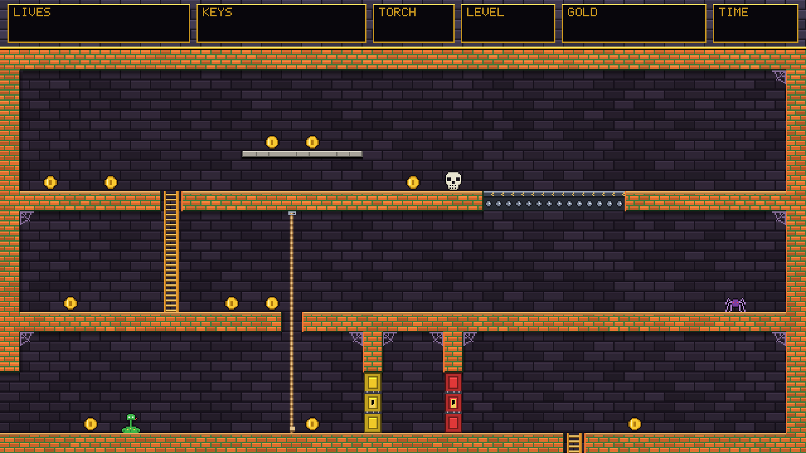

# Gold Hunter – Meilenstein 1: Projekt, Räume laden, zeichnen, messen

**Stand:** 14.11.2026 · LabVIEW 2026 (32-bit)

## Ergebnis

- Projekt `GoldHunter.lvproj` mit zwei Libraries und vier Test-VIs.
- LabVIEW lädt alle 37 Räume und zeichnet einen Raum pixelgleich zur Python-Vorschau.
- **Die Bildrate reicht mit dem Bildaufbau aus Pauls Höhenflug nicht:** rund 212 ms je Bild bei 1920 × 1080.
  Die Ursache ist gemessen, der neue Bildaufbau steht unten. Ein spielbares `Main.vi` gibt es noch nicht (M2).



## Inhalt

| Datei / Ordner | Zweck |
|---|---|
| `GoldHunter.lvproj` | Projekt mit `GH_Level.lvlib`, `GH_Render.lvlib` und dem Ordner `Tests` |
| `Source\Level\GH_Level.lvlib` | `Resource_Path`, `Room_Load` (Textdatei → Kacheln), `World_Load` (alle Räume), `Tile_At` |
| `Source\Render\GH_Render.lvlib` | `Image_Load`, `SpriteAtlas_Load`, `Sprite_Draw`, `Image_Draw`, `Room_Draw` (Objekte eines Raums) |
| `Tests\Snapshot_Room.vi` | zeichnet einen Raum und speichert ihn als `Resources\Preview\<File name>` |
| `Tests\Test_World.vi` | lädt die ganze Welt: Anzahl Räume, IDs, Summe aller Kachelwerte |
| `Tests\Test_Bench.vi`, `Test_Bench2.vi` | Zeitmessungen zum Bildaufbau |
| `build\gh_lib.py` | Typen, Konstanten (Kachelwerte, Sprite-Indizes) und die AIXML-Hilfsklasse `Doc` |
| `build\gen_game.py`, `gen_tests.py` | erzeugen die AIXML-Quellen der VIs und `build-contract.json` |

Kachelwerte (`Room_Load`): `.` 0, `#` 1, `=` 2, `~` 3, `H` 4, `|` 5, `:` 6, `<` 7, `>` 8, Türen `R B Y` 10–12,
Schlüssel `r b y` 13–15, `g` 16, `G` 17, `T` 18, `S` 19, `Z` 20, `K` 21, `P` 22.

## Verifiziert

| Prüfung | Ergebnis |
|---|---|
| Build-Contract `plan` und `verify` | alle 9 SubVIs stimmen mit dem Contract überein |
| `Test_World.vi` | 37 Räume in der richtigen Reihenfolge, Kachelsumme 23 915 = Wert aus Python |
| `Snapshot_Room.vi` (Raum 405) | 23 Sprites = Wert aus Python; Spielfeld pixelgleich zur Vorschau `screen_0_405.png` (Unterschied nur bei den Beispielwerten im HUD) |

## Messung der Bildrate (Raum 405, 1920 × 1080)

| Schritt | Zeit je Bild |
|---|---|
| HUD und Hintergrund als Bild | 9.9 ms |
| dazu 23 Sprites ins selbe Bild | 156 ms |
| dazu Rastern zu einer Pixmap (Verfahren von Pauls Höhenflug) | 212 ms |
| 23 Sprites in ein Bild **ohne** Hintergrund | 3.5 ms |
| 40 Kacheln mit NIs `Get Image Subset` ausschneiden und zeichnen | 530 ms (13 ms je Kachel) |
| drei Raumbilder laden (hell, halbdunkel, dunkel) | 78 ms |

Was das bedeutet:
- Jedes Sprite kopiert das ganze Bild, solange der 6 MB grosse Hintergrund darin steckt. Deshalb kosten 23 Sprites 146 ms.
- Ohne Hintergrund im Bild kostet ein Sprite nur 0.15 ms.
- Das Rastern des ganzen Bildschirms kostet weitere 56 ms. Auch bei 1280 × 720 wäre das Verfahren zu langsam (geschätzt 90 ms).
- `Get Image Subset` kopiert bei jedem Aufruf das ganze Raumbild und ist unbrauchbar.

## Neuer Bildaufbau (für M2)

1. Das Picture-Control löscht nie (`Erase First = never`). Der Raum wird nur beim Raumwechsel ganz gezeichnet.
2. Pro Bild werden nur die Kacheln erneuert, die sich ändern: dort, wo eine Figur war oder ist, wo eine Animation
   weiterschaltet und wo sich der Lichtkreis verschiebt.
3. Eine eigene VI `Tile_Cut` schneidet die Kachel direkt aus den Bilddaten (48 Zeilen-Ausschnitte) statt mit
   `Get Image Subset`. Darüber kommen die Sprites dieser Kacheln.

Geschätzt sind das 30 bis 60 kleine Zeichenbefehle je Bild, also wenige Millisekunden, unabhängig von der Auflösung.
1920 × 1080 bleibt deshalb das Ziel. Noch nicht gemessen sind `Tile_Cut` und die Anzeige im offenen Fenster;
ob das Bild dabei flimmert, lässt sich nur am Bildschirm beurteilen. Das ist der erste Schritt von M2.

## Neu erzeugen

```
python build\gen_game.py         # SubVI-Quellen + build-contract.json
python build\gen_tests.py        # Test-VIs
```

Danach die XML-Dateien mit dem LabVIEW-MCP in VIs umwandeln. Die aufgerufenen VIs müssen dabei über das Projekt
geöffnet sein. Vor dem Messen das Projekt schliessen: offene Frontpanels bremsen.

Erfahrungen aus diesem Meilenstein:
- Eine Konstante als Startwert eines Schieberegisters muss vor der Schleife erzeugt werden.
- Eine VI, die noch in LabVIEW geladen ist, behält beim Neuerzeugen ihre alte Fassung. `Image_Draw` hat deshalb
  weiterhin den Pflicht-Eingang `Picture`; ein neues Bild beginnt man mit `Draw Flattened Pixmap`.
